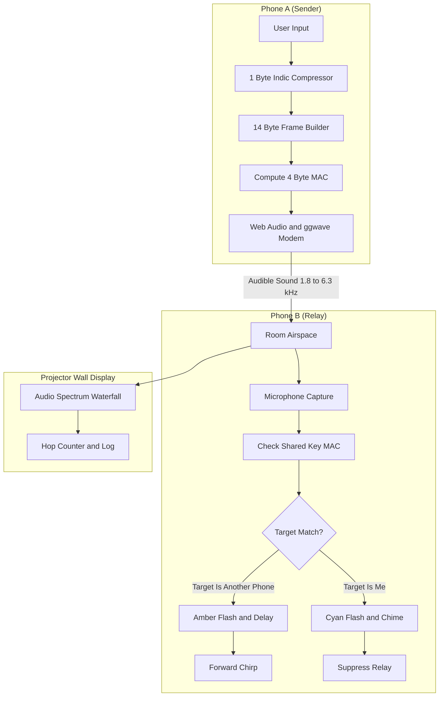

# AirGap.fm Technical Architecture

## 1. System Overview

AirGap.fm is a zero infrastructure acoustic mesh transceiver running in web browsers. It lets phones exchange short authenticated messages across rooms using audible sound waves between 1.8 kHz and 6.3 kHz.



---

## 2. Acoustic Physical Layer

### 2.1 Frequency Modulation
The acoustic modem uses multi frequency shift keying provided by the ggwave library through the browser Web Audio interface. All transmission frequencies sit between 1800 Hz and 6300 Hz. This entire range is audible to humans and sounds like short electronic chirps.

### 2.2 Airtime
Chirp duration scales with payload size. Uncompressed text alerts take several seconds to transmit. AirGap.fm fixes all packets to 14 bytes, keeping airtime to approximately 1.14 seconds per chirp.

---

## 3. 14 Byte Frame Layout

Packets use a compact 14 byte binary structure:

```
 0                   1                   2                   3
 0 1 2 3 4 5 6 7 8 9 0 1 2 3 4 5 6 7 8 9 0 1 2 3 4 5 6 7 8 9 0 1
+-+-+-+-+-+-+-+-+-+-+-+-+-+-+-+-+-+-+-+-+-+-+-+-+-+-+-+-+-+-+-+-+
|Ver|Typ|Script | Target Node ID|           Alert ID            |
+-+-+-+-+-+-+-+-+-+-+-+-+-+-+-+-+-+-+-+-+-+-+-+-+-+-+-+-+-+-+-+-+
|                         Alert Payload                         |
|           (5 Bytes: Template Params OR Indic Text)            |
+-+-+-+-+-+-+-+-+-+-+-+-+-+-+-+-+-+-+-+-+-+-+-+-+-+-+-+-+-+-+-+-+
| Hop |   TTL   |               HMAC SHA256 (32 bit)            |
+-+-+-+-+-+-+-+-+-+-+-+-+-+-+-+-+-+-+-+-+-+-+-+-+-+-+-+-+-+-+-+-+
```

| Byte Offset | Field Name | Width | Purpose |
|---|---|---|---|
| 0 | Version and Type | 1 Byte | Version (2 bits), FrameType (2 bits), ScriptId (4 bits) |
| 1 | Target Node ID | 1 Byte | 0x00 for Room Broadcast, 0xFF for Projector Wall, 0x01 to 0xFE for Unicast |
| 2 to 3 | Alert ID | 2 Bytes | Unique packet identifier for deduplication |
| 4 to 8 | Payload | 5 Bytes | Template IDs and parameters or 5 compressed Indic text bytes |
| 9 | Hop and TTL | 1 Byte | High nibble is Hop counter. Low nibble is TTL. Mutable byte excluded from MAC |
| 10 to 13 | MAC | 4 Bytes | Truncated 32 bit HMAC SHA256 over immutable bytes 0 through 8 |

---

## 4. 1 Byte Indic Delta Compressor

Standard UTF-8 encoding uses 3 bytes for every Malayalam glyph (U+0D00 to U+0D7F) and Devanagari glyph (U+0900 to U+097F). A 5 character word would require 15 bytes and exceed the frame budget.

Because active glyphs occupy a compact 128 code point block, AirGap.fm maps each character into a single byte:

```text
EncodedByte = (CodePoint - BaseOffset) & 0x7F
```

Where:
- BaseOffset for Malayalam is 0x0D00
- BaseOffset for Devanagari is 0x0900
- Standard ASCII characters map directly with the high bit set to zero

This compresses text by 66.7 percent, allowing short localized words to fit inside 5 bytes.

---

## 5. Routing and Relay Rules

1. Room Broadcast (Target 0x00): Every phone flashes green, shows the message card, and schedules a relay chirp.
2. Targeted Unicast (Target matches My Node ID): The destination phone flashes cyan, sounds an arrival chime, shows the message card, and stops retransmission.
3. Intermediate Relay (Target is another phone): The phone displays a routing banner with the target ID, hides the card body on its own screen, and passes the acoustic chirp forward. Packets travel in plain text over the air and are not encrypted.
4. Wall Sink (Target 0xFF): The projector screen logs hop numbers and shows live spectrum waterfall graphics.

---

## 6. Collision Avoidance

To prevent room wide packet collisions when multiple phones hear the same chirp, AirGap.fm uses the Trickle gossip rule from RFC 6206:
- Deduplication: Nodes record seen Alert ID and MAC pairs in memory.
- Redundancy counter k = 2: If a phone hears duplicate chirps while waiting to transmit, it cancels its own relay.
- Jitter delay: Retransmission is scheduled with a randomized delay between 1.5 seconds and 6.0 seconds.
- Hop limit: Packets discard when TTL reaches zero or hop count exceeds 15.

---

## 7. Security and Authentication Model

- Authentication: Packets are signed with a truncated 4 byte HMAC SHA256 over bytes 0 through 8.
- Pre shared demo key: The demo secret key is embedded directly in client JavaScript. Anyone with code access can forge messages. Production field use requires out of band key distribution.
- No encryption: Audio transmissions are broadcast in plain text. Any listening device running the decoder can read payload contents.
- Replay: Replay suppression relies on an in memory table of seen Alert IDs. The 14 byte wire frame contains no timestamp field.
