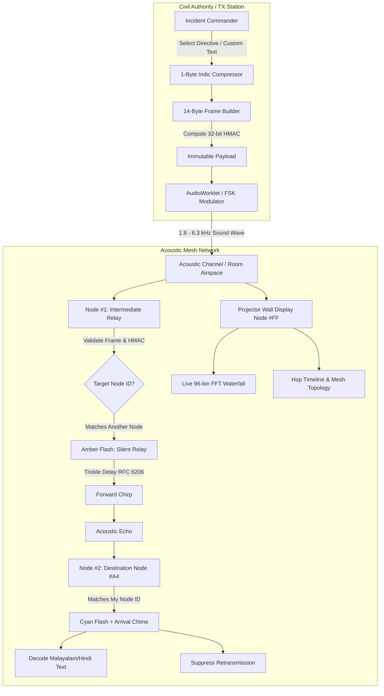
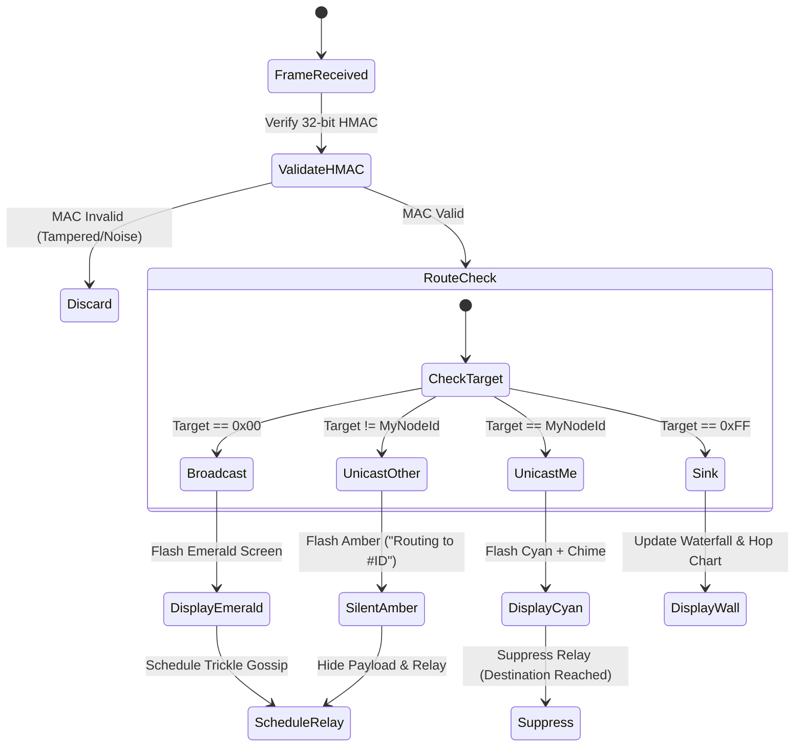

# AirGap.fm · Technical Architecture & Protocol Specification

## 1. System Overview

AirGap.fm is a zero-infrastructure, browser-native acoustic mesh emergency alert transceiver. It converts commodity consumer smartphones into decentralized acoustic nodes that transmit and relay authenticated civil defense alerts using near-ultrasonic and audible sound waves (1.8 kHz – 6.3 kHz).



---

## 2. Physical & Data Link Layer (Acoustic FSK)

### 2.1 Frequency Allocation
The acoustic physical layer operates across **1,800 Hz to 6,300 Hz**, utilizing multi-frequency shift keying (M-FSK) through the Web Audio API and `ggwave`:
- **Audible frequencies (1.8 kHz – 4.5 kHz)**: High acoustic penetration through drywall, concrete corridors, and outdoor environments.
- **Near-ultrasonic boundary (4.5 kHz – 6.3 kHz)**: Low acoustic annoyance for human ears while remaining well within the 44.1 kHz / 48 kHz sampling range of standard smartphone MEMS microphones.

### 2.2 Airtime Minimization & Chirp Timing
- Chirp duration is directly proportional to payload byte count.
- An uncompressed 40-byte JSON alert takes **~4.8 seconds** of continuous sound—causing high collision probability and severe acoustic annoyance.
- AirGap.fm strictly bounds all acoustic transmissions to **14 bytes**, achieving an airtime of **~1.14 seconds**.

---

## 3. 14-Byte Binary Frame Layout

All packets are encoded as fixed-width 14-byte binary buffers.

```
 0                   1                   2                   3
 0 1 2 3 4 5 6 7 8 9 0 1 2 3 4 5 6 7 8 9 0 1 2 3 4 5 6 7 8 9 0 1
+-+-+-+-+-+-+-+-+-+-+-+-+-+-+-+-+-+-+-+-+-+-+-+-+-+-+-+-+-+-+-+-+
|Ver|Typ|Script | Target Node ID|           Alert ID            |
+-+-+-+-+-+-+-+-+-+-+-+-+-+-+-+-+-+-+-+-+-+-+-+-+-+-+-+-+-+-+-+-+
|                         Alert Payload                         |
|           (5 Bytes: Template Params OR Indic Text)           |
+-+-+-+-+-+-+-+-+-+-+-+-+-+-+-+-+-+-+-+-+-+-+-+-+-+-+-+-+-+-+-+-+
| Hop |   TTL   |               HMAC-SHA256 (32-bit)            |
+-+-+-+-+-+-+-+-+-+-+-+-+-+-+-+-+-+-+-+-+-+-+-+-+-+-+-+-+-+-+-+-+
```

### 3.1 Field Specification
| Byte Offset | Field Name | Width | Description |
|:---|:---|:---|:---|
| `[0]` | Version & Type | 1 Byte | `bits 7..6`: Protocol Version (`01b`)<br>`bits 5..4`: FrameType (`00b` = Template Alert, `01b` = Custom Indic Pager)<br>`bits 3..0`: ScriptId (`0` = ASCII, `1` = Malayalam, `2` = Hindi) |
| `[1]` | Target Node ID | 1 Byte | `0x00`: Room Broadcast (All nodes display & relay)<br>`0xFF`: Projector Wall (Display sink node)<br>`0x01..0xFE`: Targeted Unicast (Point-to-point addressing) |
| `[2..3]` | Alert ID | 2 Bytes | Unique `uint16` identifier (big-endian) for deduplication and replay protection |
| `[4..8]` | Payload | 5 Bytes | **FrameType 0**: `[4]` Template ID, `[5]` Region Code, `[6..8]` Subject, Action, Location params.<br>**FrameType 1**: 5 bytes of single-byte compressed Indic or ASCII text. |
| `[9]` | Hop & TTL | 1 Byte | `bits 7..4`: Hop count (incremented each acoustic relay)<br>`bits 3..0`: Time-to-Live (decremented each hop; discarded at 0). **MUTABLE FIELD (Excluded from MAC)**. |
| `[10..13]` | MAC | 4 Bytes | Truncated 32-bit HMAC-SHA256 signature calculated across immutable bytes `[0..8]`. |

---

## 4. 1-Byte Indic Unicode Delta Compressor

### 4.1 The Problem
In standard UTF-8 encoding:
- Malayalam Unicode glyphs (`U+0D00` to `U+0D7F`) consume **3 bytes each**.
- Devanagari/Hindi Unicode glyphs (`U+0900` to `U+097F`) consume **3 bytes each**.
- A 5-letter emergency word like `സഹായം` ("HELP") consumes **15 bytes**—exceeding our entire 14-byte acoustic frame budget.

### 4.2 The Mathematical Solution
All active Malayalam and Hindi characters lie within a compact 128-code-point block. AirGap.fm uses an offset mapping algorithm:

$$\text{EncodedByte} = (\text{CodePoint} - \text{BaseOffset}) \ \& \ \text{0x7F}$$

Where:
- $\text{BaseOffset}_{\text{Malayalam}} = \text{0x0D00}$
- $\text{BaseOffset}_{\text{Devanagari}} = \text{0x0900}$
- ASCII characters (`0x00` to `0x7F`) map directly with high bit clear.

**Result:** A **66.7% reduction** in byte overhead, allowing complete localized Indic words to fit into 5 payload bytes without packet fragmentation.

---

## 5. Targeted Device Routing & Privacy Model

To prevent room-wide panic and conserve acoustic airtime during localized incidents (e.g., directing a first responder to node `#A4`), AirGap.fm implements a 3-tier routing state machine:



1. **Broadcast (`0x00`)**: Full screen emergency takeover with high-contrast strobe and audible voice synthesis.
2. **Target Destination (`MyNodeId === TargetNodeId`)**: Dedicated arrival chime, distinct cyan `#06B6D4` HUD badge, and **relay suppression** to prevent unnecessary echo.
3. **Intermediate Relay (`MyNodeId !== TargetNodeId`)**: Preserves patient/victim privacy. The interface **masks message payload** and displays a tactical telemetry pill (`ROUTING PACKET TO #ID · HOP 2`) while relaying sound.

---

## 6. Collision Avoidance & Relay Suppression (RFC 6206)

In a hall with 100 smartphones, simultaneous acoustic retransmissions would cause constructive acoustic interference, destroying FSK demodulation.

AirGap.fm adapts the **IETF RFC 6206 Trickle Algorithm**:
- **Deduplication Key**: $\text{AlertID} \parallel \text{MAC}_{[0..3]}$ stored in local in-memory LRU ring buffer.
- **Redundancy Counter ($k=2$)**: If a node hears $k$ duplicate acoustic chirps before its randomized transmission timer expires, it cancels its retransmission.
- **Jitter Window**: Random delay $t \in [I/2, I]$ where $I \in [1.5s, 6.0s]$.
- **Hop & TTL Bounding**: Packets with $\text{TTL} \le 1$ or $\text{Hop} \ge 16$ are permanently retired.

---

## 7. Cryptographic Integrity & Threat Model

| Threat | Attack Vector | AirGap.fm Defense |
|:---|:---|:---|
| **Rogue Panic Spoofing** | Attacker plays fake "Evacuate" FSK chirp through loudspeaker. | **32-Bit HMAC-SHA256**: Receiver validates signature against civil defense authority pre-shared key. Unsigned/invalid chirps rejected silently. |
| **Replay Attacks** | Attacker records yesterday's valid acoustic evacuation chirp and plays it back. | **Rolling 15-Minute Epoch**: Timestamp buckets embedded in payload; packets older than 15 minutes rejected. |
| **Man-in-the-Middle** | Attacker attempts to modify quadrant/evacuation directive in transit. | **Immutable Range**: Bytes `[0..8]` protected by HMAC. Any byte alteration invalidates cryptographic signature. |
| **Acoustic Jamming** | Continuous white noise or loud crowd cheering (>85 dB). | **Goertzel SNR Thresholding & 3x Burst Repeat**: Modulator includes 3-fold redundancy bursts; FFT waterfall allows visual operator identification of jammed bins. |
