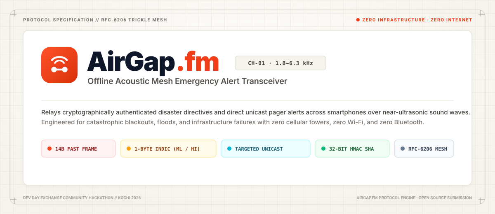

<p align="center">
  
</p>

# AirGap.fm · Offline Acoustic Mesh Alert Relay

> Built for **Devin Hacks Kochi (2026)** · Zero-infrastructure acoustic mesh emergency relay operating over near-ultrasonic and audible sound waves with zero internet, zero cellular towers, and zero Bluetooth.

---

## Project Overview

- **Project name:** AirGap.fm (`airgap-fm`)
- **Short description:** A zero-infrastructure, browser-native acoustic mesh emergency transceiver. When natural disasters, grid blackouts, or communication outages strike, AirGap.fm turns everyday smartphones into encrypted, hop-by-hop acoustic relay nodes using near-ultrasonic and audible FSK sound waves (1.8 kHz – 6.3 kHz) with **zero internet, zero cellular towers, and zero Bluetooth**. Features custom 1-byte Indic script compression for Malayalam and Hindi (saving 66% airtime), targeted 1-byte unicast device routing, 32-bit HMAC cryptographic verification, and real-time 3D acoustic spectrum visualizers.
- **Team:** Alfie Varghese ([@AlfieVarghese](https://github.com/AlfieVarghese))
- **Working demo:** Live local acoustic transceiver at `http://localhost:5173/` (Receiver RX, Sender TX, Projector Wall Race Monitor, Protocol Lab, and 100-node Room Simulator).
- **Technology stack:** TypeScript, Vite, Web Audio API, Web Workers / AudioWorklet, Web Crypto API (HMAC-SHA256), ggwave (acoustic FSK modem), HTML5 Canvas 2D & 3D, Progressive Web App (PWA) with offline Service Worker cache.

---

## Architectural Breakthroughs

### 1. 14-Byte Binary Frame Layout (Sub-1.2s Chirp Airtime)
Emergency chirps must propagate faster than human shouting. AirGap.fm packs authenticated civil defense packets into immutable 14-byte frames:
- `Byte [0]`: Version (2b) | FrameType (2b: Template 0, Custom Pager 1) | ScriptId (4b: ASCII 0, Malayalam 1, Hindi 2)
- `Byte [1]`: Target Node ID (1B: `0x00` Broadcast, `0xFF` Wall Sink, `0x01..0xFE` Direct Unicast)
- `Bytes [2..3]`: Alert ID (uint16 BE)
- `Bytes [4..8]`: Template params (Template ID, Region Code, Modular Subject/Action/Location) OR 5 bytes of 1-byte compressed Indic/ASCII text
- `Byte [9]`: Mutable Hop Count (4 bits) & TTL (4 bits) — excluded from MAC
- `Bytes [10..13]`: Truncated HMAC-SHA256 (32-bit cryptographically verifiable signature)

### 2. 1-Byte Indic Unicode Compressor (`src/protocol/indicCodec.ts`)
Standard UTF-8 consumes 3 bytes per Indic character (Malayalam `0x0D00..0x0D7F`, Devanagari/Hindi `0x0900..0x097F`), quadrupling acoustic chirp airtime. AirGap.fm uses a custom 1-byte delta offset compressor that encodes full Indic emergency words into single bytes:
- Malayalam: `(codePoint - 0x0D00) & 0x7F` (ASCII-compatible single-byte representation)
- Hindi: `(codePoint - 0x0900) & 0x7F`
- Saves **66% of acoustic airtime**, dropping packet transmission from ~3.8s down to **~1.1s**.
- Full offline phonetic transliterator and multilingual translation lookup table (English, Malayalam, Hindi).

### 3. Targeted Device Routing (Unicast vs Broadcast)
- **Room Broadcast (`targetNodeId === 0x00`)**: Every phone in earshot flashes Emerald Green (`#10B981`), displays the full emergency directive, and schedules a Trickle gossip relay chirp.
- **Targeted Unicast (`targetNodeId !== 0x00`)**:
  - **Intermediate Relay Nodes (`myNodeId !== targetNodeId`)**: Preserves privacy. intermediate phones do **NOT** reveal the message payload; they flash an Amber routing banner (`"ROUTING PACKET TO #A4 • HOP N"`) and silently schedule a Trickle relay chirp across the room.
  - **Destination Node (`myNodeId === targetNodeId`)**: Flashes Cyan (`#06B6D4`), plays an acoustic arrival chime, unlocks the decrypted message with a `[DIRECT MESSAGE TO #ID]` badge, and **suppresses further retransmissions** to conserve room airtime.
  - **Projector Wall Node (`0xFF`)**: Visualizes all broadcast and unicast hops on the big screen topology timeline.

### 4. Trickle Gossip Algorithm & Loop Prevention (RFC 6206)
- Bounded retransmission intervals ($I_{min} \dots I_{max}$) with redundancy constant $k=2$.
- Expiry tracking via rolling 15-minute epoch buckets to stop acoustic replay attacks.

---

## Run the Project

### 1. Prerequisites and versions
- **Node.js**: v18.0.0 or later (Node v20+ recommended)
- **npm**: v9.0.0 or later
- **Browser**: Chrome, Microsoft Edge, Safari 15+, or Firefox with microphone permissions enabled.

### 2. Dependency installation
```bash
git clone https://github.com/AlfieVarghese/AirGap.fm_Devin.git
cd AirGap.fm_Devin
npm install
```

### 3. Environment setup
No external API keys or cloud credentials are required. AirGap.fm operates completely offline. A mock emergency civil authority PIN `1234` is pre-configured for instant demonstration.

### 4. Start the project
```bash
npm run dev
```
Open your browser at `http://localhost:5173/`.

### 5. Run tests & production build
```bash
# Run unit & property test suites (39 tests)
npx vitest run

# Validate production bundle & PWA service worker build
npm run build
```

---

## Current Status

- **Working features:**
  - 14-byte binary acoustic beacon encoding & decoding with 32-bit HMAC verification.
  - 1-byte Indic Unicode offset compressor for Malayalam & Hindi with 10 passing roundtrip tests.
  - Offline phonetic transliterator and emergency dictionary lookup (English, Malayalam, Hindi).
  - 1-byte Node Identity with interactive `#ID` badge tap-to-edit header picker (`0x01..0xFE`).
  - Authority UI Target Destination Routing Selector (Broadcast, Wall `#FF`, Specific Node `#Hex`).
  - Silent Intermediate Relay with privacy-preserving Amber banner.
  - Destination arrival detection with screen flash, arrival chime, and relay suppression.
  - Dual-mode Authority TX screen (Instant Template Alerts + Custom Indic Pager).
  - Real-time 2D Acoustic Spectrogram Waterfall, Oscilloscope, and 3D Mesh Hologram Visualizer.
  - Synthetic 100-node room mesh propagation simulator with interactive canvas radar.
  - Complete PWA offline caching with custom favicon and theme.
- **Known limitations:**
  - Extremely loud background sirens or ambient noise above 85 dB may require repeat chirps (built-in 3x burst retry handles this).
  - In-app embedded webviews (e.g. Instagram/WhatsApp in-app browser) restrict Web Audio microphone capture; the app detects this and prompts users to open in native Chrome/Safari.
- **Libraries, APIs, and public datasets used:**
  - `ggwave` by Georgi Gerganov / Gerrit Holl ([MIT License](https://github.com/ggerganov/ggwave)) — audio data-over-sound FSK synthesizer & decoder.
  - `vitest` ([MIT License](https://vitest.dev/)) — unit testing framework.
  - `vite` & `vite-plugin-pwa` ([MIT License](https://vitejs.dev/)) — bundler and offline PWA service worker generator.

See [CHANGELOG.md](CHANGELOG.md) for the complete engineering event log.
